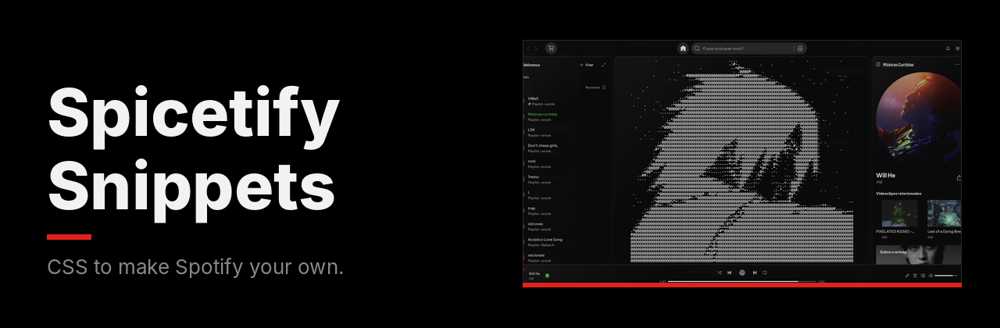
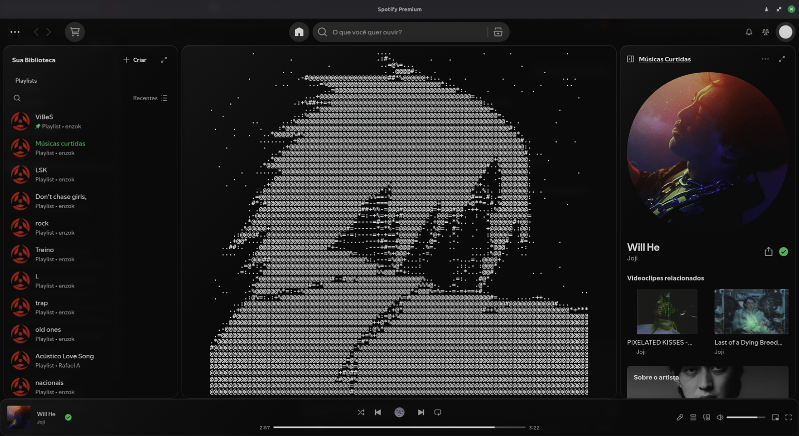
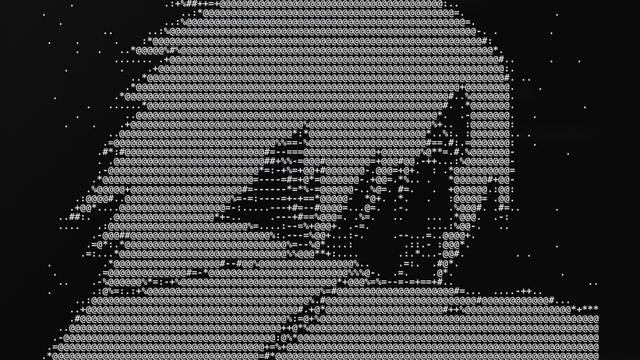
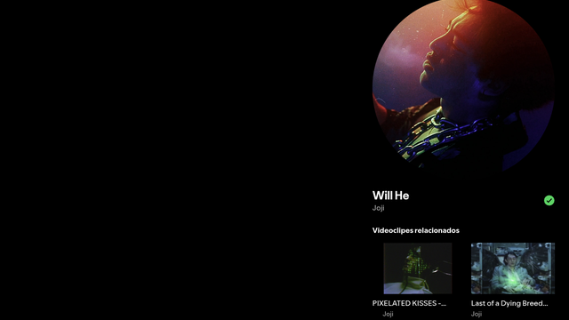
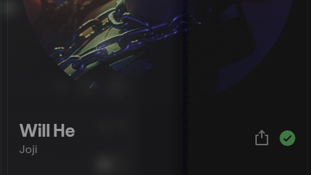
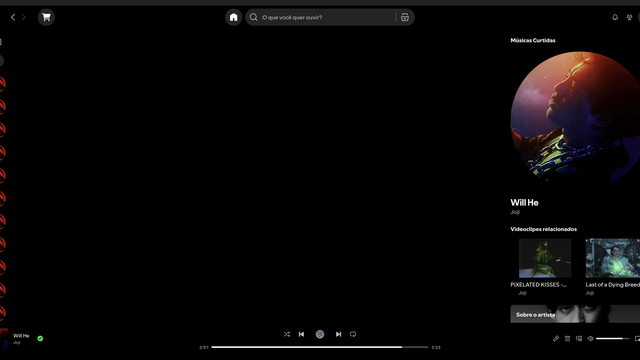
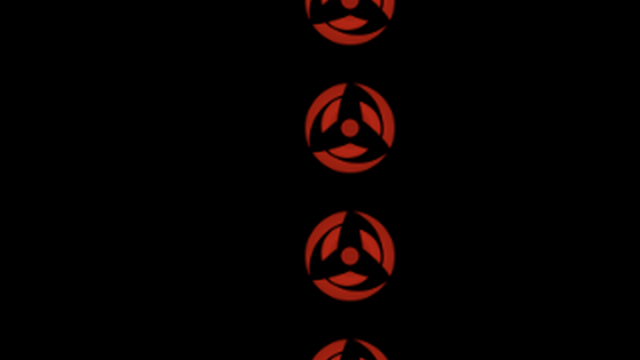
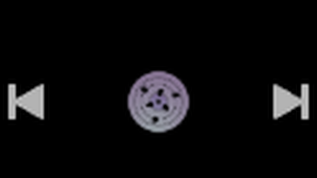

CSS snippets for [Spicetify](https://spicetify.app). Each one changes a part of Spotify and works on its own or combined with the others.

## Home screen art

A dotted drawing made of keyboard characters fills the home screen.

| | |
|---|---|
| **Where** | Home screen only. Search, playlists and albums stay the same. |
| **Clicks** | Still work: the drawing sits on top without blocking anything. |
| **Customizable** | Size, color, brightness or a whole new drawing. |
| **Best with** | [Empty home screen](empty-home-screen) |

**[See the snippet](home-screen-art)**

## All snippets

<table>
  <tr>
    <td width="50%" valign="top">
      
      <h3><a href="home-screen-art">Home screen art</a></h3>
      A dotted drawing filling the home screen.
    </td>
    <td width="50%" valign="top">
      
      <h3><a href="empty-home-screen">Empty home screen</a></h3>
      Only the background on the home screen, with transparent side panels.
    </td>
  </tr>
  <tr>
    <td width="50%" valign="top">
      
      <h3><a href="glass-effect">Glass effect</a></h3>
      Dark translucent glass panels, iOS style.
    </td>
    <td width="50%" valign="top">
      
      <h3><a href="custom-background">Custom background</a></h3>
      An image or color behind all of Spotify.
    </td>
  </tr>
  <tr>
    <td width="50%" valign="top">
      
      <h3><a href="cover-and-shape">Cover and shape</a></h3>
      One image for every library cover, in a round shape.
    </td>
    <td width="50%" valign="top">
      
      <h3><a href="rinnegan-player">Rinnegan player</a></h3>
      An animated GIF as the play/pause button.
    </td>
  </tr>
</table>

## Installation

Requires [Spicetify](https://spicetify.app) and the [Marketplace](https://github.com/spicetify/marketplace).

1. In Spotify, open the **Marketplace** and go to the **Snippets** tab.
2. Click **+ Add CSS**.
3. Paste the contents of the snippet's `.css` file.
4. Give it a name and click **Save CSS**.

## Combos

| Look | Snippets |
|---|---|
| Home screen drawing | [Empty home screen](empty-home-screen) + [Home screen art](home-screen-art) |
| Clean wallpaper | [Custom background](custom-background) + [Empty home screen](empty-home-screen) |
| Glass over your windows | [Glass effect](glass-effect) + [Custom background](custom-background) with `--bg-image: none;` + Blur my Shell |

> [!NOTE]
> Spotify renames its internal elements between versions. If a snippet stops working after an update, open an issue with a screenshot.
