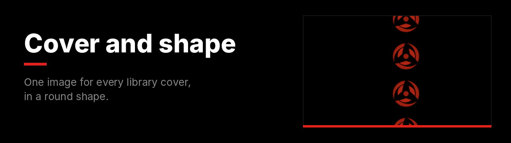
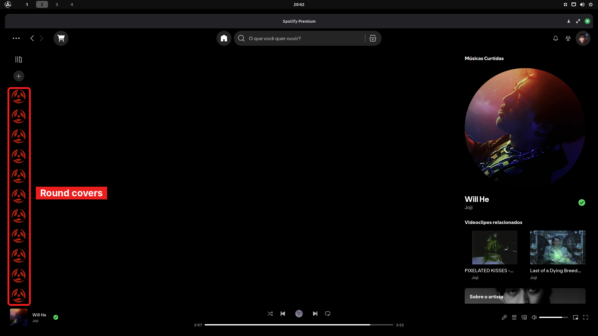

Every playlist and album in your library uses the same cover image, cut into a circle.

**File:** [`cover-and-shape.css`](cover-and-shape.css)

## What changes



| Area | Result |
|---|---|
| Library covers | All use your image. |
| Shape | Round instead of square. |
| Special covers | Playlists like **Liked Songs** get the new cover too. |

## Change the image

```css
:root {
  --cover: url("YOUR_IMAGE_LINK");
}
```

> [!TIP]
> Want only round covers with the original images? Delete the line `content: var(--cover) !important;`.

<details>
<summary><b>How to install</b></summary>
<br>

1. In Spotify, open the **Marketplace** and go to the **Snippets** tab.
2. Click **+ Add CSS**.
3. Paste the contents of [`cover-and-shape.css`](cover-and-shape.css).
4. Give it a name and click **Save CSS**.

To undo, turn it off or delete it in the **Installed** tab.
</details>

---

[All snippets](../README.md)
