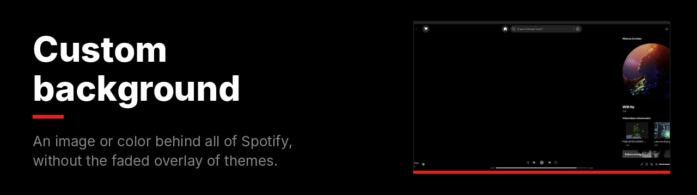
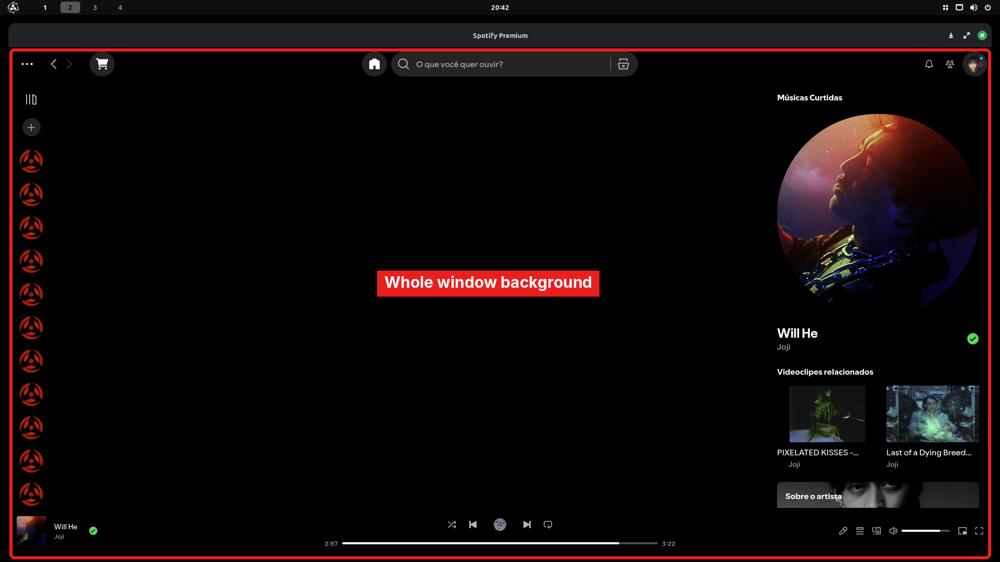

An image or solid color behind all of Spotify, without the layers themes use to tint or blur it.

**File:** [`custom-background.css`](custom-background.css)

## What changes



The whole window. The image covers everything, centered, without repeating.

## Pick an image or color

```css
:root {
  --bg-image: url("PASTE_LINK_HERE");
  --bg-color: #000000;
}
```

| I want | Do this |
|---|---|
| An image | Replace `PASTE_LINK_HERE` with a direct link ending in `.jpg`, `.png` or `.webp`. |
| Only a color | Use `--bg-image: none;` and set `--bg-color`. |

> [!TIP]
> Use images at least 1920 px wide. On Pinterest, replace `/236x/` or `/736x/` in the link with `/originals/`.

<details>
<summary><b>How to install</b></summary>
<br>

1. In Spotify, open the **Marketplace** and go to the **Snippets** tab.
2. Click **+ Add CSS**.
3. Paste the contents of [`custom-background.css`](custom-background.css), with your link or color.
4. Give it a name and click **Save CSS**.

To change the image later, edit the snippet in the **Installed** tab.
</details>

---

[All snippets](../README.md)
