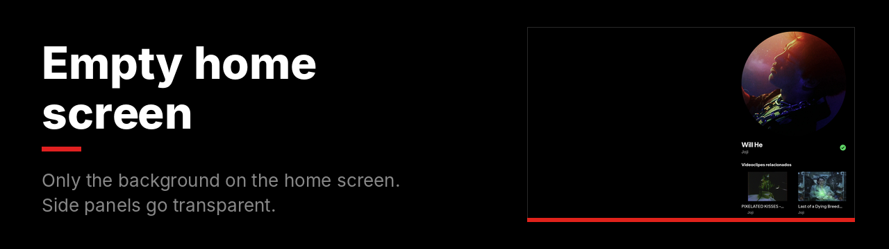
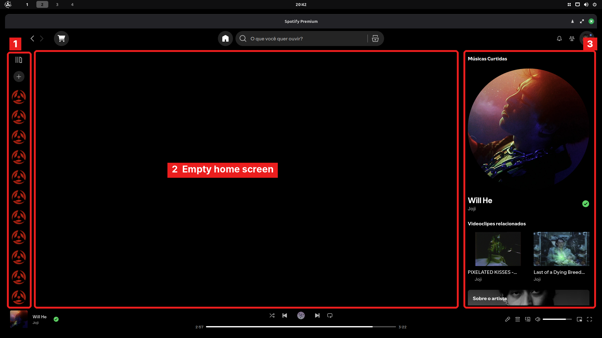

The home screen shows only the background, with no filters, shortcuts or albums. The side panels lose their dark background, so your wallpaper shows behind everything.

**File:** [`empty-home-screen.css`](empty-home-screen.css)

## What changes

| | Area | Result |
|:-:|---|---|
| **1** | Library | Transparent background. |
| **2** | Home screen | Filters, shortcuts and album rows hidden. |
| **3** | Now playing | Transparent panel, with covers and videos still visible. |

> [!TIP]
> Only the home screen is empty. Search, playlists and albums open normally.

**Best with:** [Custom background](../custom-background)

<b>How to install</b>

 

1. In Spotify, open the **Marketplace** and go to the **Snippets** tab.
2. Click **+ Add CSS**.
3. Paste the contents of [`empty-home-screen.css`](empty-home-screen.css).
4. Give it a name and click **Save CSS**.

To undo, turn it off or delete it in the **Installed** tab.

---

[All snippets](../README.md)
