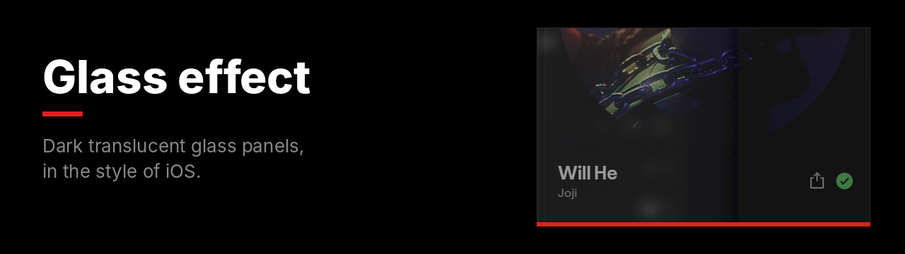
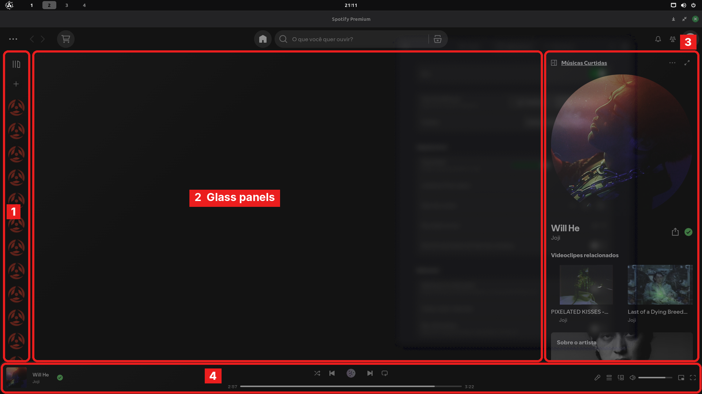

Spotify's panels become dark translucent glass, with blur, a thin border, a top highlight and a shadow. With **Blur my Shell** on GNOME, you can see the windows behind Spotify.

**File:** [`glass-effect.css`](glass-effect.css)

## What changes



| | Panel | Detail |
|:-:|---|---|
| **1** | Library | Glass with rounded corners. |
| **2** | Main area | Glass, also inside playlists, albums and search. |
| **3** | Right panel | Glass. |
| **4** | Player | Glass control bar. |

## Customize

```css
:root {
  --glass-blur: 28px;
  --glass-tint: rgba(0, 0, 0, 0.45);
  --glass-border: rgba(255, 255, 255, 0.10);
  --glass-radius: 18px;
}
```

| Variable | Controls |
|---|---|
| `--glass-blur` | Blur strength. |
| `--glass-tint` | Glass darkness. For light glass, use `rgba(255,255,255,0.10)`. |
| `--glass-border` | Border color. |
| `--glass-radius` | Corner radius. |

## See the windows behind Spotify

CSS only changes what's inside Spotify. For a see-through window, use the GNOME extension **Blur my Shell**, in the **Applications** tab:

1. Turn on **Blur** and pick **Dynamic**.
2. Under **Window class**, add `Spotify`.
3. Set **Opacity** between **90 and 95**.
4. Turn off **Opaque focused window**.
5. Under **Pipeline**, pick **Classic Dark Background** or **Liquid Glass**.
6. Restart Spotify.

> [!IMPORTANT]
> Below 90 opacity, Spotify's text becomes hard to read.

> [!TIP]
> Use with [Custom background](../custom-background) set to `--bg-image: none;` and `--bg-color: #000000;`.

<details>
<summary><b>How to install</b></summary>
<br>

1. In Spotify, open the **Marketplace** and go to the **Snippets** tab.
2. Click **+ Add CSS**.
3. Paste the contents of [`glass-effect.css`](glass-effect.css).
4. Give it a name and click **Save CSS**.

To undo, turn it off or delete it in the **Installed** tab.
</details>

---

[All snippets](../README.md)
