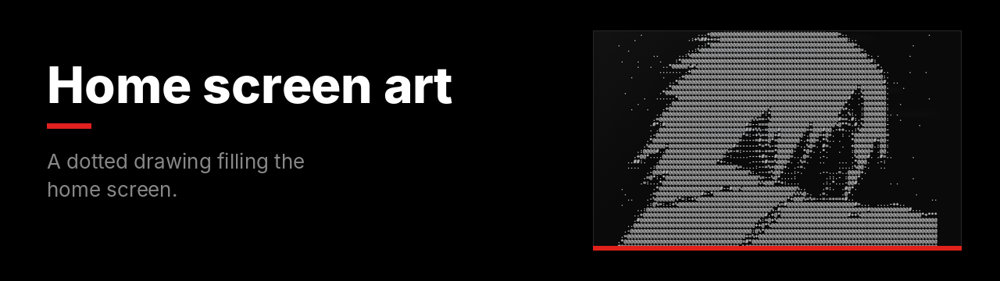
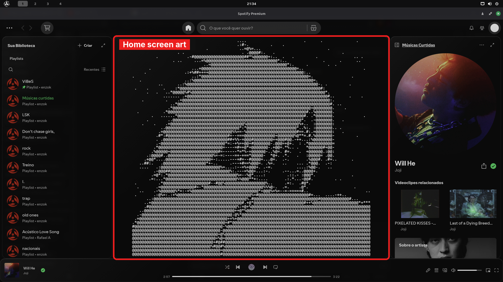

A dotted drawing made of keyboard characters, centered on the home screen.

**File:** [`home-screen-art.css`](home-screen-art.css)

## What changes

| Area | Result |
|---|---|
| Home screen | The drawing fills the center. |
| Other pages | Nothing changes. |
| Clicks | Still work through the drawing. |

## Customize

Everything is in the `::after` block:

| I want | Change |
|---|---|
| Smaller or bigger | Lower or raise both numbers in `font-size: min(1.4vh, 0.85vw)`. |
| Faded, like a watermark | The last number in `color: rgba(255, 255, 255, 0.85)`, e.g. `0.3`. |
| Another color | The first three numbers in `color`. `224, 34, 27` is red. |
| Thinner font | `font-weight: 700` → `400`. |

## Use your own drawing

The drawing lives inside `content: "..."`, with each line separated by `\A ` (backslash, A, space).

1. Turn an image into text art with [ASCII Art Generator](https://www.asciiart.eu/image-to-ascii) or [Braille ASCII Art](https://lachlanarthur.github.io/Braille-ASCII-Art/).
2. Join the lines with `\A ` and paste it between the quotes.

> [!IMPORTANT]
> The art can't contain quotes (`"`) or backslashes (`\`). Replace them with another symbol first.

> [!TIP]
> Pairs well with [Empty home screen](../empty-home-screen).

<b>How to install</b>

 

1. In Spotify, open the **Marketplace** and go to the **Snippets** tab.
2. Click **+ Add CSS**.
3. Paste the contents of [`home-screen-art.css`](home-screen-art.css).
4. Give it a name and click **Save CSS**.

To undo, turn it off or delete it in the **Installed** tab.

---

[All snippets](../README.md)
