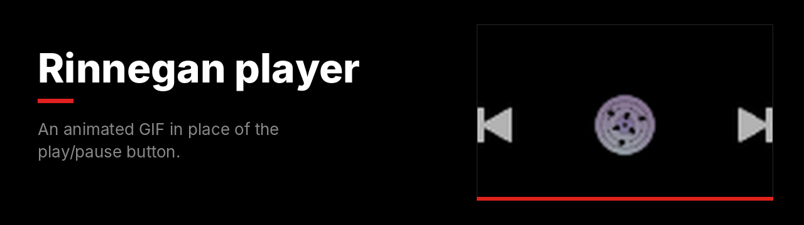
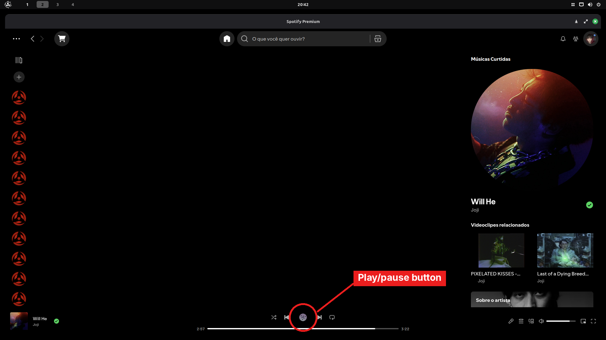

The play/pause button becomes an animated GIF. The original button is still underneath, so clicks work as usual.

**File:** [`rinnegan-player.css`](rinnegan-player.css)

## What changes

## Customize

| I want | Change |
|---|---|
| Another GIF | The link inside `url('...')`. Works with `.gif`, `.png` and `.webp`. |
| Bigger or smaller | The three `40px` values (`width`, `height`, `min-width`). |

> [!TIP]
> GIFs with a transparent background look best.

<b>How to install</b>

 

1. In Spotify, open the **Marketplace** and go to the **Snippets** tab.
2. Click **+ Add CSS**.
3. Paste the contents of [`rinnegan-player.css`](rinnegan-player.css).
4. Give it a name and click **Save CSS**.

To undo, turn it off or delete it in the **Installed** tab.

---

[All snippets](../README.md)
